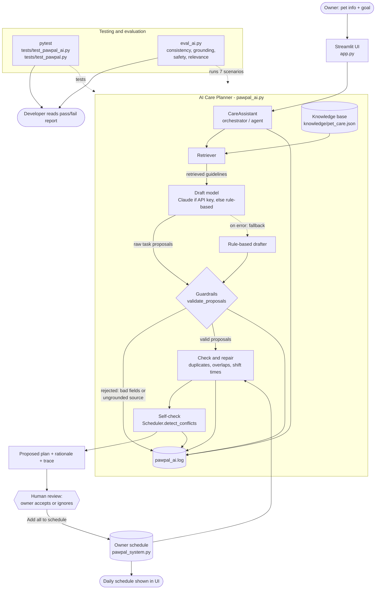

# 🐾 PawPal+ — AI-Assisted Pet Care Planner

PawPal+ is a Streamlit app that helps a busy pet owner plan care across multiple pets. This version adds an **AI Care Planner** that retrieves vetted care guidelines, drafts a daily plan from them, and checks that plan against the owner's real schedule before suggesting it.

## Original project (Modules 1–3)

**PawPal+** began as a scheduling app. Its goals were to let an owner track care tasks (walks, feeding, meds, grooming) for several pets and to produce a clear daily plan. It modeled `Owner`, `Pet`, `Task`, and `Scheduler` classes, sorted and filtered tasks by time, priority, and completion, auto-created the next occurrence of daily/weekly tasks, and warned about same-time conflicts. This final project extends that system with an AI layer rather than replacing it.

## What it does and why it matters

Owners often know *that* their pet needs care but not *what a good routine looks like* or *when to fit it in*. The AI Care Planner answers "what should I schedule for Mochi?" with a concrete, conflict-free set of tasks, each with a one-sentence reason and the guideline it came from. Suggestions are grounded in a knowledge base instead of free-form model output, and nothing is added to the schedule until the owner approves it.

## Architecture overview



(Also saved as `diagrams/system_diagram.mmd`; the original class diagram is `diagrams/uml_draft.mmd`.)

| Layer | File | Role |
|---|---|---|
| UI | `app.py` | Collects pets, tasks, and goals; shows the schedule, AI suggestions, and the AI's step-by-step trace. |
| Scheduling core | `pawpal_system.py` | `Owner`, `Pet`, `Task`, `Scheduler`: sorting, filtering, recurrence, conflict warnings. |
| AI planner | `pawpal_ai.py` | Retrieval, drafting, guardrails, repair, self-check, logging. |
| Knowledge base | `knowledge/pet_care.json` | 11 guidelines, tagged by species and life stage, each with structured task templates. |
| Evaluation | `tests/`, `eval_ai.py` | Unit tests and a reliability harness. |

**Data flow:** the owner's goal and pet profile go in → the retriever selects guidelines matching species, life stage (from age), and goal keywords → a model drafts tasks using *only* those guidelines → guardrails reject invalid or ungrounded drafts → the repair step removes duplicates and shifts overlapping tasks → the real `Scheduler` verifies the result → the owner reviews and accepts. Humans check the AI at the review step; automated checks run at the guardrail and self-check steps; developers use `pytest` and `eval_ai.py`.

## Setup instructions

Requires Python 3.10+.

```bash
git clone <this-repo-url>
cd ai110-module2show-pawpal-starter
python -m venv .venv
source .venv/bin/activate        # Windows: .venv\Scripts\activate
pip install -r requirements.txt
streamlit run app.py
```

Then open the URL Streamlit prints (usually http://localhost:8501). Add a pet, scroll to **🤖 AI Care Planner**, optionally type a goal, and click **Generate plan**.

**No API key is needed.** By default the planner uses a deterministic, offline drafter. To use Claude for drafting instead:

```bash
export ANTHROPIC_API_KEY=your-key       # PowerShell: $env:ANTHROPIC_API_KEY="your-key"
export PAWPAL_MODEL=claude-sonnet-5-5   # optional override
```

Other commands:

```bash
python -m pytest     # 23 tests
python eval_ai.py    # reliability harness (7 scenarios)
python demo_ai.py    # printed demo of the AI planner and guardrails
python main.py       # CLI demo of the scheduling core
```

Every AI run is logged to `pawpal_ai.log` (git-ignored).

## Sample interactions

These are real outputs from the offline drafter. Mochi (4-year-old dog) already has a "Vet call" at 7:30 AM for 30 minutes.

**1. Goal: "more exercise" (Mochi, dog)**

```
Retrieved 1 guideline(s) for dog/adult: dog-exercise
Validated 2 of 2 drafted task(s).
Moved 'Morning walk' to 8:00 AM to avoid a conflict.
Self-check passed: no schedule conflicts.

 8:00 AM  Morning walk  30 min  high    [dog-exercise]  (moved off the vet call)
 6:00 PM  Evening walk  30 min  medium  [dog-exercise]
```

The default 7:30 AM walk collided with the existing vet call, so the agent shifted it to the next free slot and re-verified.

**2. Goal: "feeding" (Luna, a 3-year-old cat added to the same owner)**

```
Retrieved 1 guideline(s) for cat/adult: cat-feeding
Moved 'Breakfast' to 8:00 AM to avoid a conflict.
Self-check passed: no schedule conflicts.

 8:00 AM  Breakfast           10 min  high    [cat-feeding]
12:00 PM  Refresh water bowl   5 min  medium  [cat-feeding]
 6:30 PM  Dinner              10 min  high    [cat-feeding]
```

Conflict checking is owner-wide, not per pet: the owner can't feed Luna during Mochi's vet call, so Luna's breakfast moved too. A different species and goal retrieved a different guideline and produced a different plan.

**3. Goal: "astrophysics" (off-topic input)**

```
Retrieved 0 guideline(s) for dog/adult: none
No relevant guidelines found; no plan generated (guardrail).
```

The system declines instead of inventing advice.

## Reproducible execution evidence

Everything below is real output, produced with the offline drafter (no API key, no network) and saved in [`evidence/`](evidence/). Reproduce it from the project root after setup:

```bash
python demo_ai.py   > evidence/demo_output.txt     # example inputs, AI outputs, guardrail results
python -m pytest -v > evidence/pytest_output.txt   # 23 automated tests
python eval_ai.py   > evidence/eval_output.txt     # reliability harness, 7 scenarios
```

### 1. Example inputs and AI outputs, plus guardrail results — `python demo_ai.py`

```text
=== Example 1-3: planning ===

INPUT : pet=Mochi (dog, age 4), goal='more exercise'
OUTPUT: model=rule-based confidence=0.88 verified=True
   8:00 AM  Morning walk - 30 min, high [dog-exercise] (moved to avoid conflict)
   6:00 PM  Evening walk - 30 min, medium [dog-exercise]
TRACE :
  - Retrieved 1 guideline(s) for dog/adult: dog-exercise
  - Validated 2 of 2 drafted task(s).
  - Moved 'Morning walk' to 8:00 AM to avoid a conflict.
  - Self-check passed: no schedule conflicts.
  - Confidence: 0.88

INPUT : pet=Luna (cat, age 3), goal='feeding'
OUTPUT: model=rule-based confidence=1.00 verified=True
   8:00 AM  Breakfast - 10 min, high [cat-feeding] (moved to avoid conflict)
  12:00 PM  Refresh water bowl - 5 min, medium [cat-feeding]
   6:30 PM  Dinner - 10 min, high [cat-feeding]
TRACE :
  - Retrieved 1 guideline(s) for cat/adult: cat-feeding
  - Validated 3 of 3 drafted task(s).
  - Moved 'Breakfast' to 8:00 AM to avoid a conflict.
  - Self-check passed: no schedule conflicts.
  - Confidence: 1.00

INPUT : pet=Mochi (dog, age 4), goal='astrophysics'
OUTPUT: model=rule-based confidence=0.00 verified=False
  (no plan)
TRACE :
  - Retrieved 0 guideline(s) for dog/adult: none
  - No relevant guidelines found; no plan generated (guardrail).

=== Guardrail results ===

valid proposal         -> ACCEPTED
duration 0             -> Rejected item 1: duration out of range
start time 03:00       -> Rejected item 1: start time outside 05:00-22:00
frequency 'hourly'     -> Rejected item 1: bad frequency
invented source_id     -> Rejected item 1: not grounded in a retrieved guideline
empty description      -> Rejected item 1: description empty or too long
not an object          -> Rejected item 1: not an object
```

### 2. Automated tests — `python -m pytest -v`

```text
============================= test session starts =============================
platform win32 -- Python 3.14.7, pytest-9.2.0, pluggy-1.7.0 -- <project>\.venv\Scripts\python.exe
cachedir: .pytest_cache
rootdir: <project>
plugins: anyio-4.16.0
collecting ... collected 23 items

tests/test_pawpal.py::test_mark_complete_changes_task_status PASSED      [  4%]
tests/test_pawpal.py::test_adding_task_increases_pet_task_count PASSED   [  8%]
tests/test_pawpal.py::test_scheduler_sorts_tasks_by_time PASSED          [ 13%]
tests/test_pawpal.py::test_scheduler_filters_by_pet_name_and_completion PASSED [ 17%]
tests/test_pawpal.py::test_completing_daily_task_adds_next_days_occurrence_to_same_pet PASSED [ 21%]
tests/test_pawpal.py::test_completing_weekly_task_adds_next_weeks_occurrence PASSED [ 26%]
tests/test_pawpal.py::test_completing_one_time_task_does_not_create_another_occurrence PASSED [ 30%]
tests/test_pawpal.py::test_scheduler_warns_when_different_pets_have_tasks_at_same_time PASSED [ 34%]
tests/test_pawpal.py::test_scheduler_warns_about_same_pet_conflicts_and_ignores_completed_tasks PASSED [ 39%]
tests/test_pawpal_ai.py::test_retriever_matches_species_and_goal PASSED  [ 43%]
tests/test_pawpal_ai.py::test_retriever_returns_nothing_for_irrelevant_goal PASSED [ 47%]
tests/test_pawpal_ai.py::test_life_stage_boundaries PASSED               [ 52%]
tests/test_pawpal_ai.py::test_retrieval_changes_output PASSED            [ 56%]
tests/test_pawpal_ai.py::test_guardrails_reject_bad_and_ungrounded_proposals PASSED [ 60%]
tests/test_pawpal_ai.py::test_guardrails_handle_non_list_output PASSED   [ 65%]
tests/test_pawpal_ai.py::test_plan_avoids_conflicts_with_existing_schedule PASSED [ 69%]
tests/test_pawpal_ai.py::test_plan_skips_duplicates PASSED               [ 73%]
tests/test_pawpal_ai.py::test_bad_model_falls_back_safely PASSED         [ 78%]
tests/test_pawpal_ai.py::test_hallucinating_model_is_filtered PASSED     [ 82%]
tests/test_pawpal_ai.py::test_apply_plan_adds_tasks_without_conflicts PASSED [ 86%]
tests/test_pawpal_ai.py::test_no_guidelines_means_no_plan PASSED         [ 91%]
tests/test_pawpal_ai.py::test_confidence_is_scored_and_reflects_quality PASSED [ 95%]
tests/test_pawpal_ai.py::test_confidence_zero_when_model_output_all_rejected PASSED [100%]

============================= 23 passed in 0.07s ==============================
```

### 3. Reliability harness — `python eval_ai.py`

```text
Model: rule-based

| Scenario | Goal | Consistent | Grounded | Safe | Relevant | Confidence | Result |
|---|---|---|---|---|---|---|---|
| dog/4 | more exercise | pass | pass | pass | pass | 0.88 | PASS |
| dog/0 | puppy training | pass | pass | pass | pass | 1.00 | PASS |
| dog/10 | medication | pass | pass | pass | pass | 1.00 | PASS |
| cat/3 | feeding | pass | pass | pass | pass | 1.00 | PASS |
| cat/3 | litter | pass | pass | pass | pass | 1.00 | PASS |
| other/2 | clean cage | pass | pass | pass | pass | 1.00 | PASS |
| dog/4 | astrophysics | pass | pass | pass | pass | 0.00 | PASS |

7/7 scenarios passed. Mean confidence on scenarios with a plan: 0.98.
```

To see the runtime log written by the app and these commands, open `pawpal_ai.log` (git-ignored); each plan, guardrail rejection, model fallback, and confidence score is recorded there.

## Design decisions and trade-offs

- **RAG over free generation.** The model may only use retrieved guidelines and must cite one. *Trade-off:* it can't answer anything outside the knowledge base, but its suggestions are traceable and it can't make up care advice. Guardrails enforce this by rejecting any proposal whose `source_id` was not retrieved.
- **Offline fallback by default.** A deterministic drafter makes the project runnable and reproducible by anyone without a key or network, and doubles as the fallback when Claude errors. *Trade-off:* offline suggestions are templated, less flexible than an LLM's.
- **Keyword retrieval, not embeddings.** It's simple, dependency-free, deterministic, and easy to test and explain. *Trade-off:* it misses synonyms ("exercise" works because it's a tag; "stretch their legs" would not).
- **Agentic check-and-repair with a bounded loop.** The planner verifies its own output against the real schedule and fixes conflicts (max 5 shifts of 15 minutes, then drops the task). *Trade-off:* a simple greedy shift is predictable but not globally optimal; high-priority tasks claim slots first.
- **Human in the loop.** Suggestions are never applied automatically. This costs one extra click and keeps the owner in control.
- **Reused the existing scheduler for verification.** The final check calls the original `Scheduler.detect_conflicts` instead of duplicating logic, so the AI layer and core app can't disagree.
- **Stricter than the core check.** The planner treats overlapping *durations* as conflicts, whereas the original `detect_conflicts` only flags identical start times.

## Testing summary

- **23 tests pass** (9 original scheduling tests + 14 AI tests), covering retrieval relevance and species filtering, confidence scoring, life-stage boundaries, guardrail rejection of bad fields and ungrounded sources, non-list model output, conflict repair, duplicate skipping, model-crash fallback, a hallucinating model, and applying a plan.
- **`eval_ai.py` passes 7/7 scenarios**, each run twice, checking consistency (identical output), grounding (every task cites a retrieved guideline), safety (no remaining conflicts), and relevance (expected task type appears; off-topic goal yields no plan).
- **What worked:** designing guardrails as plain functions made them easy to test with bad inputs, and injecting fake models (`Broken`, `Hallucinator`) tested failure paths without any API.
- **What didn't / gaps:** the tests exercise the offline drafter; the Claude path (`ClaudeModel`) has not been run in automated tests since it needs a key and network, so it relies on the same guardrails rather than its own tests. Consistency checks are trivial for a deterministic drafter and would be more meaningful against an LLM. There are no automated Streamlit UI tests.
- **What I learned:** the most valuable AI code was the code that *distrusts* the AI: validation, grounding checks, and verification. Testing the failure behavior mattered more than testing the happy path.

### Reliability results

**Summary:** 23 of 23 automated tests passed; 7 of 7 evaluation scenarios passed (mean confidence 0.98 on scenarios that produced a plan). Reliability is measured four ways: automated tests, a confidence score on every plan, logging with error handling, and the evaluation harness below. These ran against the offline drafter; no human evaluation was done.

**Confidence scoring.** Each plan gets a 0–1 heuristic score (shown in the UI and logged): the average of retrieval strength (how well the best guideline matches the goal), validation rate (share of drafted tasks passing the guardrails), and placement rate (share of valid tasks placed rather than dropped). It is 0 if the self-check fails or nothing valid is drafted. It is a quality heuristic, not a calibrated probability.

**Logging and error handling.** `pawpal_ai.log` records each plan (pet, goal, retrieved guidelines), every guardrail rejection, model failures and fallbacks, and the final confidence. Model errors fall back to the offline drafter; a broken knowledge base raises a clear error shown in the UI.

**Evaluation harness output** (`python eval_ai.py`, copied from a real run):

| Scenario | Goal | Consistent | Grounded | Safe | Relevant | Confidence | Result |
|---|---|---|---|---|---|---|---|
| dog/4 | more exercise | pass | pass | pass | pass | 0.88 | PASS |
| dog/0 | puppy training | pass | pass | pass | pass | 1.00 | PASS |
| dog/10 | medication | pass | pass | pass | pass | 1.00 | PASS |
| cat/3 | feeding | pass | pass | pass | pass | 1.00 | PASS |
| cat/3 | litter | pass | pass | pass | pass | 1.00 | PASS |
| other/2 | clean cage | pass | pass | pass | pass | 1.00 | PASS |
| dog/4 | astrophysics (off-topic) | pass | pass | pass | pass | 0.00 | PASS (correctly produced no plan) |

**Failure-mode tests** (`tests/test_pawpal_ai.py`):

| Test input | Evaluation criteria | Result |
|---|---|---|
| Model raises `TimeoutError` | Falls back, still returns a plan | Pass |
| Model cites an invented `source_id` | Proposal rejected, no plan | Pass |
| Model returns a non-list / malformed items | Rejected without crashing, confidence 0 | Pass |
| Duration 0, start 3 AM, frequency "hourly", empty description | Each rejected by guardrails | Pass |
| Existing task at 7:30 AM overlaps default walk | Walk shifted, self-check passes | Pass |
| Task already scheduled | Not suggested again | Pass |
| Off-topic goal | No guidelines retrieved, no plan | Pass |

The 0.88 for "more exercise" is the only score below 1.0: only one of its two goal keywords ("exercise") matches the guideline, so retrieval strength is lower; time shifts do not reduce confidence. Scores of 1.00 mostly reflect the offline drafter producing already-valid templates, so they are less informative than they will be against a real LLM.

## Reflection

Building this showed me that useful AI features are mostly engineering around the model: deciding what it's allowed to see, what it's allowed to say, and how to check it. Grounding the output in retrieved sources and re-verifying it against the real schedule made the behavior predictable and debuggable, and the trace makes the reasoning visible to users. I also learned to keep the system useful when the model is unavailable, rather than treating the model as a hard dependency.

## Limitations

See [model_card.md](model_card.md) for the full responsible-AI reflection (limitations and biases, misuse, surprises, and AI collaboration).


- The knowledge base is small, general guidance and **not veterinary advice**.
- Retrieval is keyword-based and can miss paraphrased goals.
- Repair is greedy and may drop a task when no slot is found nearby.
- Task times are limited to 5:00 AM–10:00 PM, and plans are for a single day.

## Smarter scheduling (core features)

| Feature | Method(s) | Notes |
|---------|-----------|-------|
| Task sorting | `Scheduler.sort_by_time()`, `Scheduler.get_tasks()` | Sorted chronologically, then by priority. |
| Filtering | `Scheduler.filter_tasks()`, `Scheduler.get_tasks()` | By pet name, completion status, and date. |
| Conflict detection | `Scheduler.detect_conflicts()` | Warns about pending tasks with identical start times, across pets. |
| Recurring tasks | `Task.mark_complete()`, `Scheduler.mark_task_complete()` | Completing a daily/weekly task creates the next occurrence on the same pet. |
